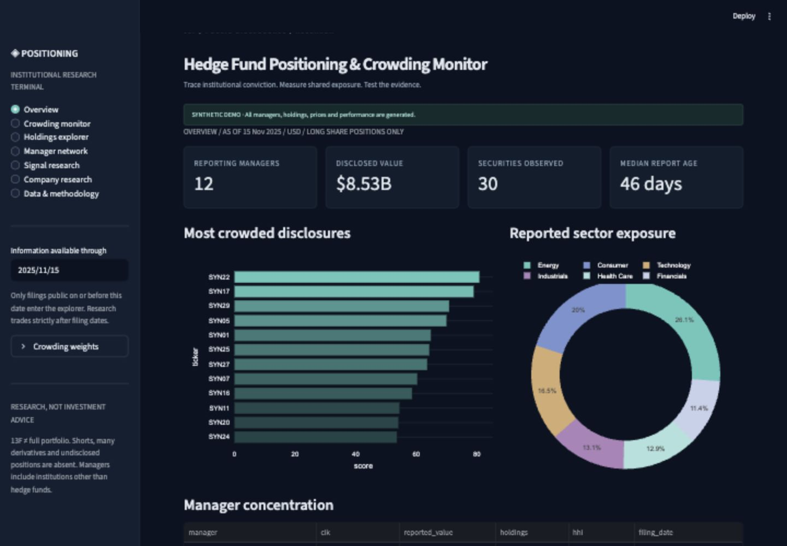
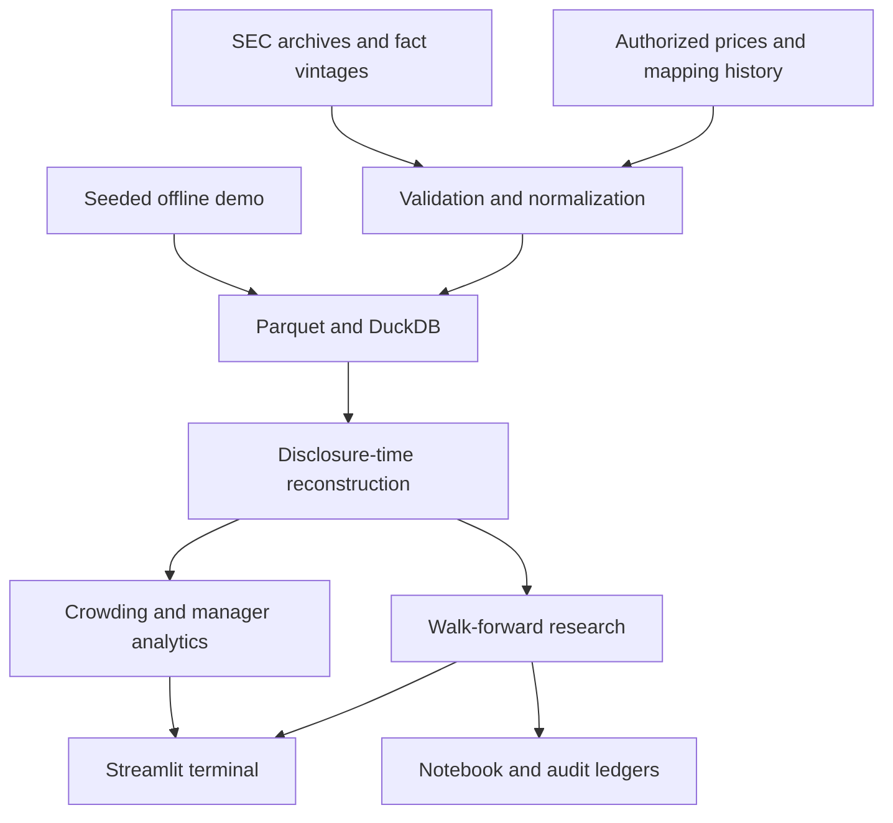
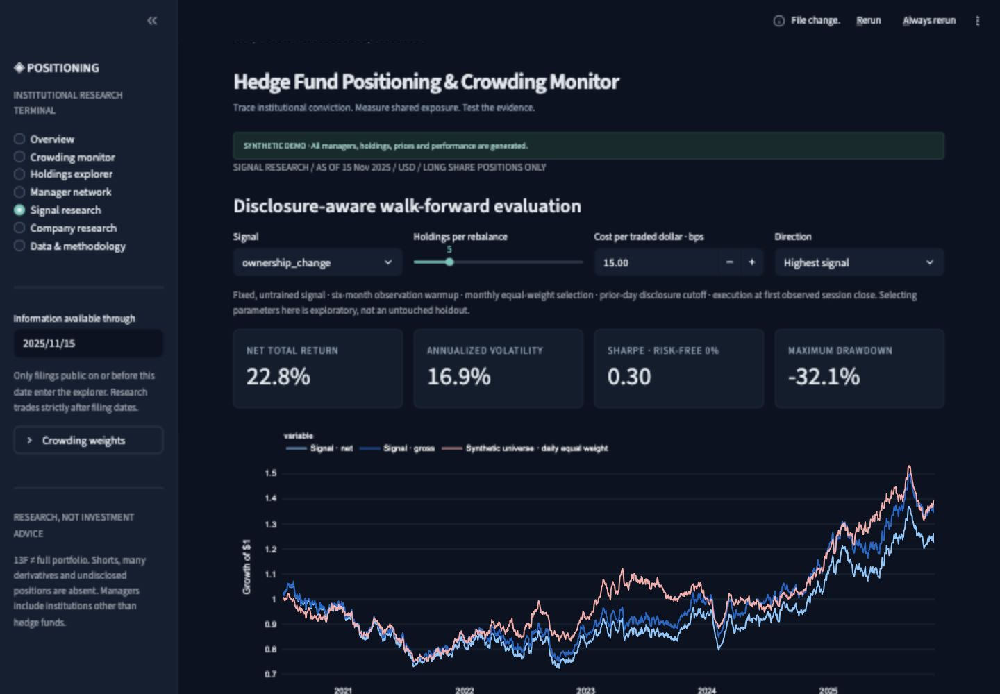

# Hedge Fund Positioning & Crowding Monitor

**A disclosure-aware research terminal for institutional long-equity positioning.**

Explore reported portfolios, decompose crowded exposures, map manager similarity,
and test positioning signals using information that was actually public.

Python · pandas · NumPy · SciPy · scikit-learn · DuckDB · Parquet · Streamlit · Plotly

> **Synthetic demo:** every bundled manager, security, holding and price is
> generated. Resulting performance demonstrates the software, not an investment
> edge. Real SEC ingestion and provenance-required price import are separate workflows.



## Research question

Do changes in publicly disclosed institutional positions predict subsequent
stock returns after actual disclosure delays and plausible trading costs?

The platform exposes assumptions that can otherwise create misleading results:
filing dates, amendments, coverage, identifiers, missing prices and turnover.
13F reporters include institutions other than hedge funds. Their disclosures are
neither complete portfolios nor current holdings.

## Research workspaces

| Workspace | Capability |
|---|---|
| Overview | Reported value, sector exposure, concentration and report age |
| Crowding monitor | Configurable five-component score, heatmap, decomposition and CSV export |
| Holdings explorer | Name/CIK search, historical quarters, new disclosures, exits and reported-share changes |
| Manager network | Cosine similarity, weighted overlap, average-linkage clusters and concentration |
| Signal research | Monthly walk-forward simulation, costs, 1/3/6-month IC, drawdown, sector attribution and regime diagnostics |
| Company research | Prices, reporting holders and issuer-validated SEC fact vintages when loaded |
| Data & methodology | Provenance, DuckDB filing summary, availability rules and limitations |

## Quick start

Python 3.11 or 3.12 recommended. Run from the repository root:

```bash
python -m venv .venv
source .venv/bin/activate
pip install -e '.[dev]'
streamlit run app.py
```

Open `http://localhost:8501`. Cached Parquet data works without external requests
after installation. On Windows activate `.venv\Scripts\activate`.

```bash
python -m crowding.cli demo
python -m crowding.cli research --output outputs/research
pytest -q
ruff check .
python scripts/execute_notebook.py
```

[Reproducible research notebook](notebooks/01_disclosure_time_research.ipynb)
audits availability, compares 0/15/50-bps costs, and summarizes IC and sectors.
`requirements-lock.txt` records the verified Python 3.12 development environment;
platform-specific entries may need adjustment outside macOS. The portable package
ranges in `pyproject.toml` are used by CI and hosting.

## New to quantitative finance?

Start with the [five-minute beginner walkthrough](docs/GETTING_STARTED.md).
You can use the interface without coding after setup. The included synthetic
data teaches the workflow; real-world research requires verified input data.

## Mathematical design

The crowding heuristic combines cross-sectional percentile ranks of manager
breadth (30%), disclosed value (20%), holder-value HHI (15%), matched-manager
ownership change (20%), and mean cosine similarity among holders (15%). Weights
are normalized and configurable. This is **not an established industry measure**.
High holder concentration and broad ownership describe different risks.

Backtests use `filing_date < execution_date`, executing at the first observed
session close each month. The baseline is a fixed ranking rule with six months
of observation warmup, not a forecasting model trained on future labels.
Restatements replace reports and additive amendments add entries, only once public.

Portfolio weights drift between rebalances. Traded notional is the sum of
absolute asset-weight changes: initial entry costs one notional, full replacement
two. A proportional NAV haircut models costs. Missing held-asset prices stop the
research rather than manufacturing returns.

[Full formulas, assumptions and evaluation protocol →](docs/METHODOLOGY.md)

## Architecture



The calculation engine is independent of Streamlit. Parquet is canonical;
DuckDB supplies analytical views. SEC requests use identifying contact headers,
checksummed caches, bounded retries and a shared single-process rate limiter.
Dashboard page loads do not trigger live crawling.

[Architecture plan and repository structure →](docs/ARCHITECTURE.md)

## Real public data

The SEC adapter reads official 13F TSV archives, retains actual filing dates,
excludes options/non-share amounts and applies the official dollar-unit change
with documented overrides. SEC submissions and company-facts JSON are supported.

Real prices require source/license/retrieval metadata and total-return treatment.
Mappings preserve validity and knowledge dates. No PitchBook scraping, proprietary
data, guessed identifiers or vendor price redistribution is included.

**The real-price import contract is implemented; an unattended vendor price feed
is not.** Supply authorized prices and historical mappings before empirical
research. SEC schema and cache behavior are fixture-tested; a full live SEC
universe has not been audited.

[Data contract, licensing and source references →](docs/DATA.md)

## Sample findings — synthetic only

The checked-in seed-441 data contains 12 generated managers and 30 securities.
For the default five-security ownership-change rule, with full price history
through December 31, 2025, the executed CLI produced:

| Diagnostic | Generated-demo result |
|---|---:|
| Net total return | 26.39% |
| Annualized volatility | 16.76% |
| Sharpe, zero risk-free assumption | 0.33 |
| Maximum drawdown | −32.09% |

These are software demonstration results, not evidence about actual stocks.
The dashboard defaults to the last filing date, November 15, 2025, so its return
differs from the full-history CLI run. Match the cutoff when comparing outputs.
The notebook verifies that higher costs reduce net performance and all fold
information predates execution.



## Verification

Tests cover disclosure dates, amendment semantics, stale reports, mapping
knowledge dates, missing-manager treatment, financial identities, forward-return
horizons, IC, transaction costs, drifting turnover, sector timing, missing-price
rejection, SEC parsing/caching, price provenance, deterministic Parquet/DuckDB
storage and all seven dashboard pages.

GitHub Actions runs lint, tests, demo generation, the CLI and notebook on Python
3.11 and 3.12. Local verification uses Python 3.12; remote CI has not run until
this repository is pushed. See [verification record](docs/VERIFICATION.md).

## Material limitations

- Disclosures omit shorts, many derivatives, confidential positions and some
  foreign assets. Reported value is not AUM; shared discretion can double-count.
- Selection/survivorship bias and changing coverage affect scores and returns.
  Latest-known reports can mix quarters; missing reports are not exits.
- Share changes are not split-adjusted trades. Real corporate actions, delistings,
  permanent identifiers and exchange calendars require audited input data.
- Simulation is monthly, long-only and unlevered. No borrow, capacity, liquidity
  impact calibration, taxes or forced terminal liquidation is modeled.
- Parameter exploration is not an untouched holdout. The fixed-rule evaluation
  is not purged ML cross-validation. Overlapping labels defeat naive significance
  tests; no statistical significance or investment edge is claimed.
- Demo dates are business weekdays including exchange holidays; generated data
  has no real fundamentals or corporate actions.

## Deployment and license

Docker and Streamlit Community Cloud instructions are included. The demo needs
no proprietary dataset or API keys. [Deployment guide →](docs/DEPLOYMENT.md)

Code: MIT. Generated observations: CC0-1.0. Third-party data retains its own terms.
Research software, not investment advice or trade execution.
